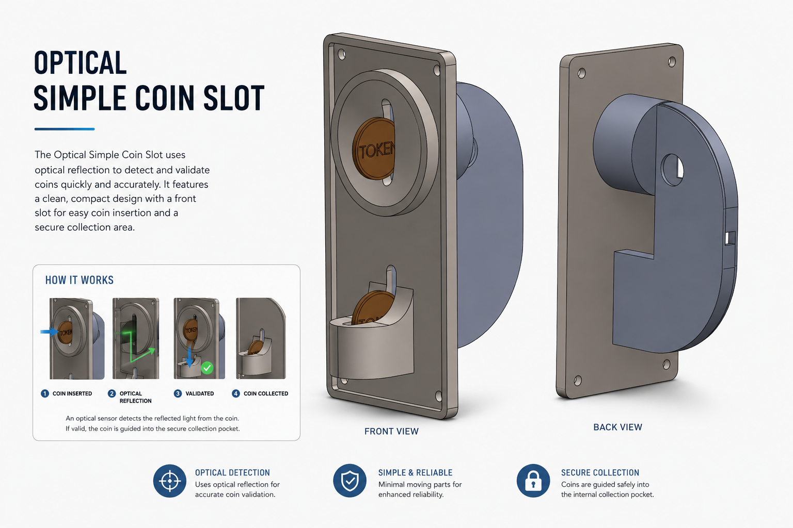
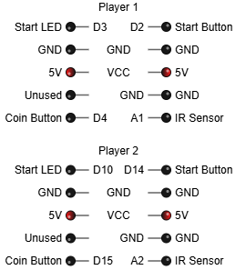
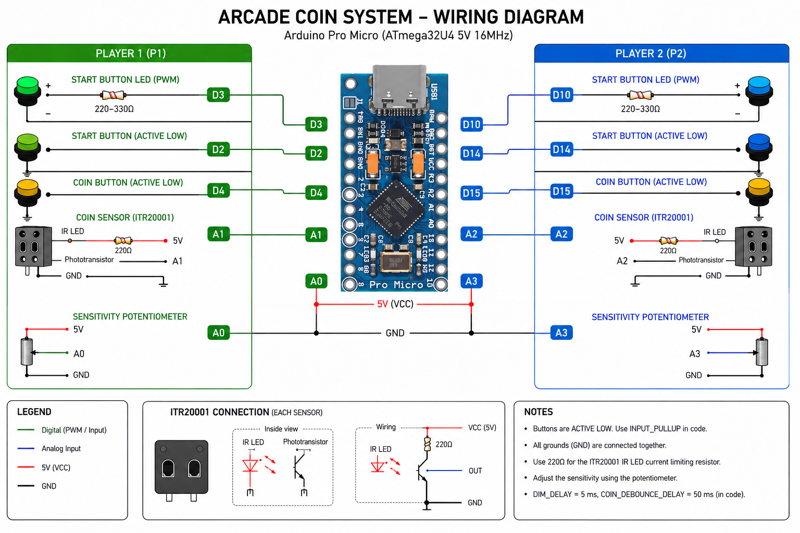

# IRCoinSlot - Optical Simple Coin Slot for DIY Arcade Machines
IR Coin Slot is a simple and effective coin detection system designed for DIY arcade machines. 
It utilizes an IR reflective sensor to detect coins as they pass through the slot, providing 
reliable and accurate coin detection for various coin sizes and materials. The design is 
compact and easy to integrate into arcade machines, making it an ideal choice for hobbyists 
and DIY enthusiasts looking to add coin-operated functionality to their projects.

## Features
- Detects coins using an IR reflective sensor.
- Simple design for easy integration into DIY arcade machines.
- Compatible with u32u4-based microcontrollers.
- Provides reliable coin detection for various coin sizes.
- Adjustable sensitivity for the sensor to accommodate different coin materials.
- Compact and durable design suitable for arcade environments.
- Easy to install and maintain.
- USB interface for easy connectivity to microcontrollers and arcade machine systems.
- Keyboard emulation support for seamless integration with arcade machine software.
- Coin-insert buttons for both players send the same credit key and LED animation as the IR sensors, with one credit per debounced press.

## Specifications
- Sensor Type: ITR20001/T IR Reflective Sensor
- Coin Detection Range: 10mm to 20mm
- Power Supply: 5V USB
- Output: USB HID (Keyboard Emulation)
- Dimensions: 50mm x 100mm x 4mm

## Concept image

## Installation
1. Make 1 x 28mm holes in your arcade machine's coin slot area to mount the coin slot securely.
2. Use the measurement guide provided to ensure proper alignment of the second hole for the coin slot.
3. Install the coin guides on the inside of the arcade machine in the 2 x 28mm holes.
4. Align the coin slot front plate with the holes and secure it in place using screws or adhesive.
5. Mount the IR sensor in the designated square hole in the coin guides, ensuring it is properly positioned to detect coins passing through the slot.
6. Connect the sensor to the microcontroller in the proper IO ports as per the wiring diagram provided in the documentation.
7. Connect a 10 kohm potentiometer to the sensor for sensitivity adjustment, if necessary.
8. Flash the microcontroller with the appropriate firmware to enable coin detection functionality.
9. Test the coin slot by inserting coins and verifying that the sensor detects them correctly and sends the appropriate signals to the microcontroller.
10. Adjust the sensitivity of the sensor using the potentiometer if needed to ensure reliable coin detection for different coin types and materials.

## Debug Serial output

With `DEBUG` set to `true`, open the Serial Monitor at 115200 baud to see timestamped coin detections, coin-button presses, start-button presses, keys sent, and LED fading start/stop events. Every two seconds, an `AIN` readout shows each enabled player's raw coin sensor value, raw sensitivity potentiometer value, calculated threshold, and detection status. The firmware never waits on Serial: debug text is queued in a 512-byte buffer and sent only as fast as USB accepts it. Text queued before a Serial Monitor connects is kept until one does, and new text is dropped if the buffer fills. Set `DEBUG` to `false` to disable Serial output.

The sensitivity potentiometer adjusts the absolute detection threshold, not an offset from a calibrated idle reading. Its raw `sensitivity_pot_adc` value (0-1023) maps to `detection_threshold_adc` (200-800), and detection occurs when `coin_adc` exceeds that threshold. Lower thresholds make detection more sensitive; higher thresholds require a stronger sensor signal. `above_threshold_adc` shows the signed difference between the coin reading and the threshold: positive means detected, zero or negative means not detected. Adjustments take effect on every sensor poll; the updated values print every two seconds.

## Pinouts

Set `P2_ENABLE` in the firmware to `true` to enable Player 2 (default: `false`). When disabled, Player 2's pins are not configured, its inputs are not polled, and no Player 2 keyboard events or LED updates are generated. Player 1 remains active.

Connect each optional coin-insert button between its input pin and GND: `P1_COIN_BUT` on pin 7 and `P2_COIN_BUT` on pin 15. Internal pull-ups are enabled. A press sends Player 1's credit key (`5`) or Player 2's credit key (`6`) and starts that player's repeating LED fade. Release the button for at least 50 ms before pressing again.

All buttons are interrupt-driven: `P1_BUT` (pin 2, INT1), `P1_COIN_BUT` (pin 7, INT6), `P2_BUT` (pin 14, PCINT3) and `P2_COIN_BUT` (pin 15, PCINT1). The interrupt records a press as soon as it happens, even while the firmware is busy, and the main loop sends the key right away. Any button pin you change must also be interrupt-capable on the ATmega32u4: pins 0, 1, 2, 3 or 7, or pin-change pins 8–11 or 14–17.

Each enabled player's LED uses PWM (`P1_LED` pin 3, `P2_LED` pin 10) and is off at startup. An accepted IR coin or coin-button press starts continuous fading from off up to full brightness and back, with a 2-second cycle (`k_dim_duration_ms`). A start-button press sends one start key (`1` or `2`) immediately, stops that player's fading, and turns the LED off. Holding Start does not repeat the key; release it for at least 50 ms before pressing again. A new credit starts the fading again.

### Pin headers out from CoinSlot Controller Box

### Wiring Diagram
